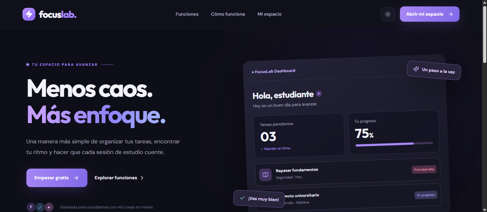
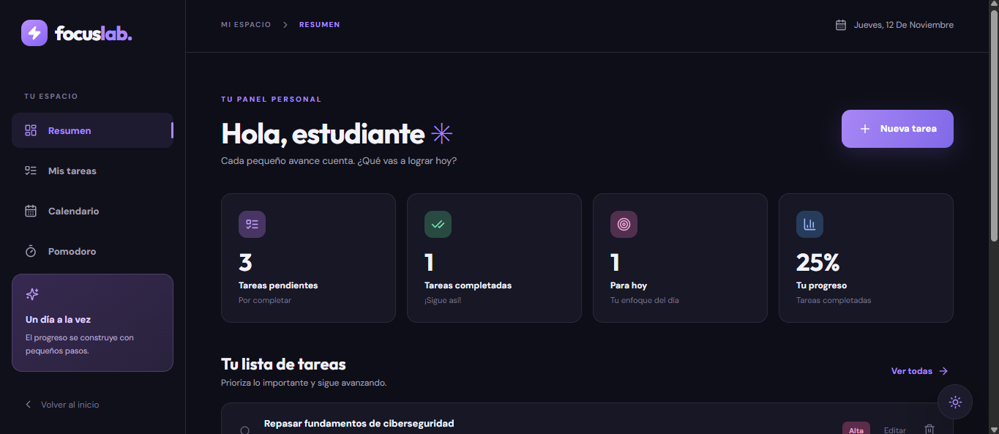
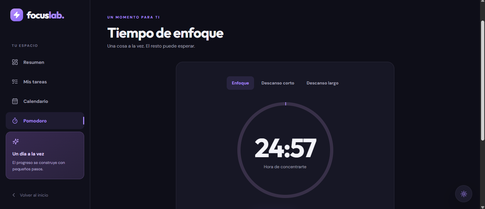

# FocusLab | Estudia con intención

[](https://github.com/katolanding/focuslab-student-dashboard/actions/workflows/deploy.yml)

**Aplicación de productividad académica** desarrollada con React, Vite y CSS responsive. Incluye una landing page y un panel de organización personal.

**[Abrir la aplicación en vivo](https://katolanding.github.io/focuslab-student-dashboard/)** · [Ver código fuente](https://github.com/katolanding/focuslab-student-dashboard) · [Ver ejecuciones CI/CD](https://github.com/katolanding/focuslab-student-dashboard/actions)

## Capturas de pantalla

### Landing page



### Panel de productividad



### Temporizador Pomodoro



## Funcionalidades

- Gestión de tareas: crear, editar, completar, eliminar y filtrar.
- Categorías, fechas de entrega y prioridades.
- Calendario mensual con indicación de tareas.
- Temporizador Pomodoro para sesiones de 25 minutos y descansos de 5 y 15 minutos.
- Resumen de tareas pendientes, completadas y para hoy; porcentaje de avance.
- Modo claro y oscuro; diseño adaptable a celular.
- Persistencia local mediante `localStorage`.

## Tecnologías

**React 18 · JavaScript · Vite · CSS · Lucide React · Node Test Runner · GitHub Actions · GitHub Pages**

## Instalación y ejecución local

Requiere Node.js compatible con Vite 6 y npm.

```bash
npm install
npm run dev
```

Abre la dirección que indique Vite (habitualmente `http://localhost:5173`). Para ejecutar pruebas y generar la versión de producción:

```bash
npm test
npm run build
npm run preview
```

## Calidad y despliegue

El flujo [`Test and deploy FocusLab`](https://github.com/katolanding/focuslab-student-dashboard/actions/workflows/deploy.yml) instala dependencias, ejecuta las pruebas y genera el sitio con Vite antes de desplegarlo en GitHub Pages. La ejecución consultada el **12 de noviembre de 2026** finalizó correctamente. El estado actualizado aparece en la insignia al comienzo del README.

El proyecto utiliza `base: '/focuslab-student-dashboard/'` cuando se compila para GitHub Pages. Si se cambia el nombre del repositorio, debe actualizarse esa ruta en `vite.config.js`.

## Estructura

```text
src/App.jsx           Interfaz y funcionalidades
src/styles.css        Diseño responsive y temas
src/utils.js          Validaciones y cálculos de tareas
src/main.jsx          Entrada de React
tests/                Pruebas automatizadas
.github/workflows/     Pruebas y despliegue en GitHub Pages
landing.png           Captura de portada
dashboard.png         Captura del panel
pomodoro.png          Captura del temporizador
```

## Alcance y privacidad

**Proyecto de portafolio en fase beta, sin cuentas ni backend.** Las tareas se almacenan en el navegador utilizado; no existe sincronización ni respaldo en la nube. No ingreses información sensible. El temporizador funciona mientras la pestaña está abierta y no es un cronómetro preciso en segundo plano.

## Próximas mejoras

- Accesibilidad: navegación con teclado y auditoría Lighthouse.
- Búsqueda y filtros por fecha.
- Registro histórico de sesiones de concentración.
- Autenticación y base de datos, únicamente en una futura versión con controles de seguridad apropiados.

## Autoría

Proyecto personal de aprendizaje y portafolio.
